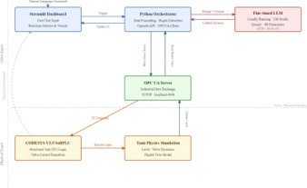

<div align="center">

# 🧠⚙️ AI ASSISTANT FOR INSTRUMENTATION & CONTROL
### Enterprise-Grade Closed-Loop Industrial Automation & Supervisory Framework

[]()
[-orange?style=flat-square)]()
[-green?style=flat-square)]()
[]()
[]()

</div>

---

## 📋 1. SYSTEM BLUEPRINT & ARCHITECTURE

This repository hosts an advanced **Digital Twin and AI Supervisory Control System** designed to bridge high-level generative intelligence with low-level deterministic Programmable Logic Controllers (PLCs)[cite: 66]. The system features a locally hosted, fine-tuned Qwen3-4B model acting as an active "AI Operator" that oversees continuous physical processes while a custom algorithmic layer handles real-time control physics[cite: 66].

### System Architecture Diagram
> *Place your architecture diagram image inside the `assets/` folder as `architecture_diagram.png`.*



---

## ⚙️ 2. ENGINEERING MODULES & CORE COMPONENTS

| Module ID | Component Name | Underlying Technology | Operational Role & Purpose |
| :--- | :--- | :--- | :--- |
| **MOD-01** | **Industrial Simulation** | CODESYS V3.5 SoftPLC | Emulates physical plant dynamics (Tank Level, Boiler Temp, Pressure) with strict safety clamping[cite: 67]. |
| **MOD-02** | **Communication Bridge** | Asynchronous OPC UA (`asyncua`) | Establishes a non-blocking 1.0s cyclic data stream over `opc.tcp://localhost:4840`[cite: 67]. |
| **MOD-03** | **Algorithmic Control** | Custom Deadband-Compensating PID | Overcomes 45%–55% actuator stiction via heuristic jumps (`+55.2` / `-44.8`) and tolerance idling[cite: 67]. |
| **MOD-04** | **Intelligence Engine** | Qwen3-4B (LoRA, 4-bit Quantized) | Executes local on-premise inference, dynamic context injection, and regex command generation. |
| **MOD-05** | **Supervisory HMI** | Streamlit Web Framework | Renders live telemetry, process gauges, system state badges, and deduplicated alarms[cite: 68]. |

---

## 🚀 3. EXECUTION & DEPLOYMENT WORKFLOW

### Prerequisites & Hardware Specifications
* **GPU:** NVIDIA GTX 1650 (4 GB GDDR6 VRAM)
* **CPU:** Intel Core i5 / AMD Ryzen 5 or higher[cite: 20]
* **System RAM:** 16 GB minimum
* **Software:** Python 3.10+[cite: 37], CODESYS V3.5 (Control Win SysTray x64), LM Studio[cite: 28], Anaconda.

### Step-by-Step Launch Sequence

1. **Clone & Install Dependencies:**
   ```bash
   git clone [https://github.com/YOUR_USERNAME/AI-Assistant-Instrumentation-LLM.git](https://github.com/YOUR_USERNAME/AI-Assistant-Instrumentation-LLM.git)
   cd AI-Assistant-Instrumentation-LLM
   pip install -r requirements.txt
